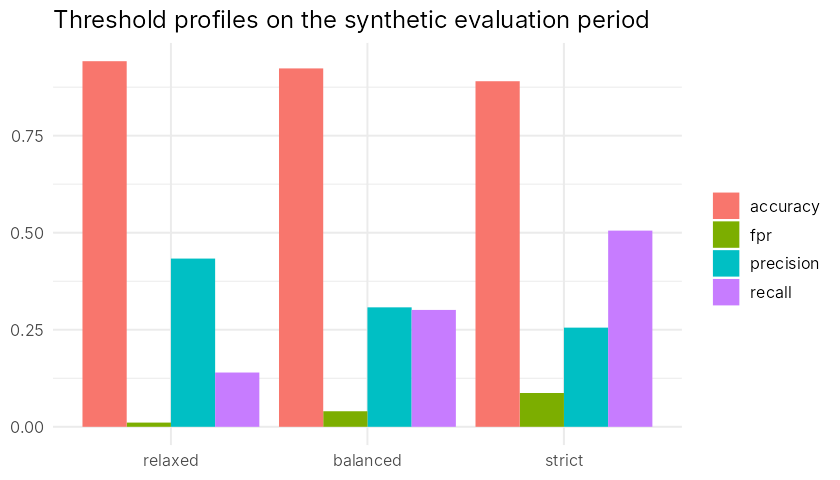
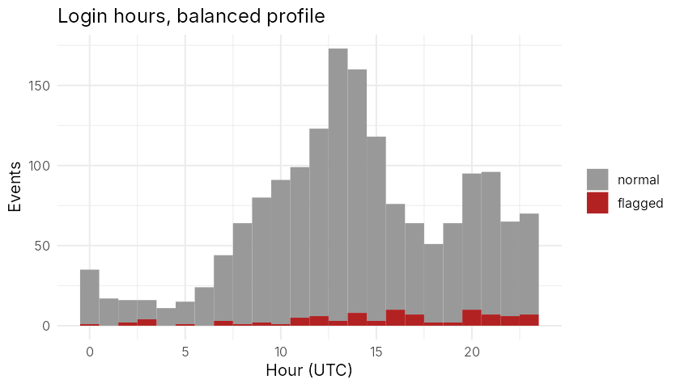
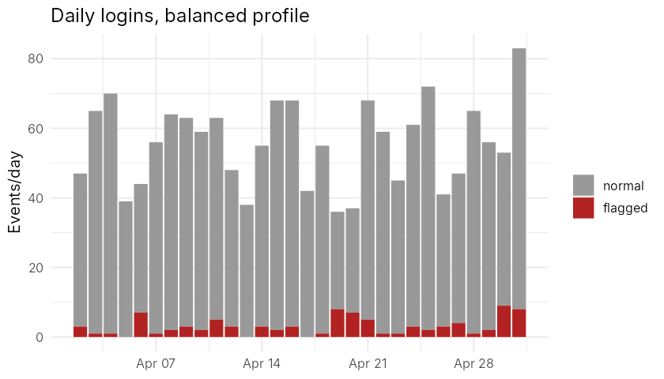

```{r setup, include=FALSE}
knitr::opts_chunk$set(echo = FALSE, warning = FALSE, message = FALSE)
setwd(rprojroot_dir <- normalizePath(file.path(getwd(), "..")))
source("report/results.R")
```

# 1. Introduction
LoginLens flags statistically unusual login events using transparent, explainable rules. **All data are synthetic and fictional**; no real login records were used. Results therefore describe behaviour on simulated data and are not evidence about real systems. A flag means "unusual", never "confirmed attack".

# 2. Workflow


# 3. Synthetic data
`R/generate_data.R` (seed 42) simulates `r nrow(ev)` events for 25 fictional users over 60 days: a 30-day **baseline** (`r sum(!e)` events, no injected anomalies) and a 30-day **evaluation** period (`r sum(e)` events, `r sum(truth)` injected anomalies). Each user has a preferred hour (mean/sd), a mean daily login rate with negative-binomial over-dispersion, weekend dampening, a failure probability, devices and a home location. Normal behaviour deliberately looks odd sometimes: 10% of logins occur at a random hour, and 1% of logins are preceded by 2-3 mistyped-password failures. Injected anomalies: unusual login hour (4-12 h from the user's usual), high daily frequency (3-8 extra logins), failed-login bursts (3-9 failures in 8 minutes). Ground-truth columns (`is_injected_anomaly`, `anomaly_type`) are dropped inside `compute_features()` and used only by `evaluate.R`.

# 4. Method and derivations
**Hour rarity.** For user $u$ with baseline hour counts $n_h$ ($N$ events): $$P_u(h)=\frac{(Kn)_h+\alpha}{N+24\alpha},\quad K_{hk}\propto \exp\!\Big(-\tfrac{d_c(h,k)^2}{2\sigma^2}\Big),\ d_c(h,k)=\min(|h-k|,24-|h-k|)$$ with $\alpha=0.5$, $\sigma=1$ h, and $K$ row-normalised so $\sum_h (Kn)_h=N$ and hence $\sum_h P_u(h)=1$ and every $P_u(h)>0$ (no infinite surprisal). The circular distance makes 23:00 and 00:00 neighbours. Surprisal is $-\log_2 P_u(h)$. Flag if $P_u(h)<r/24$ ($r$ = hour ratio: 0.10, 0.20, 0.30). Users with fewer than 20 baseline events use the pooled profile.

**Daily frequency.** For the $k$-th login of a user-day: $$z=\min\!\Big(\frac{k-\bar x_u}{\max(s_u,1)},\,10\Big)$$ where $\bar x_u,s_u$ are the mean and sd of the user's baseline daily counts (zero-count days included). The floor of 1 handles $s_u=0$; the cap keeps scores finite; only same-day past events are used. Users without enough history get no frequency evidence. *Limitation:* daily counts are discrete and right-skewed, so a normal-based z-score is only approximate; a Poisson/negative-binomial model would be better.

**Failed bursts.** $B_i$ = number of failures by the same user in the 10 minutes up to and including event $i$ (trailing window, no look-ahead). Flag if $B_i\ge b$ ($b$ = 6, 4, 3).

**Combined score.** $S=\max\big(\tfrac{-\log_2P_u(h)}{-\log_2(r/24)},\ \tfrac{\max(z,0)}{z^*},\ \tfrac{B}{b}\big)$; flag iff $S\ge1$. The reason text states which rules fired.

| Profile | hour ratio r | z* | burst b |
|---|---|---|---|
| relaxed | 0.10 | 3.5 | 6 |
| balanced | 0.20 | 3.0 | 4 |
| strict | 0.30 | 2.5 | 3 |

Thresholds were fixed before looking at results (principled round values), not tuned to the labels.

**Evaluation.** With TP, FP, TN, FN: precision = TP/(TP+FP), recall = TP/(TP+FN), FPR = FP/(FP+TN), accuracy = (TP+TN)/total. A zero denominator gives NA.

# 5. Results (actual computed output, evaluation period only)
```{r}
knitr::kable(fmt3(res), caption = "Confusion counts and metrics per profile (same evaluation data)")
```


```{r}
knitr::kable(fmt3(by_type[, c("profile", "type", "n", "detected", "recall")]), caption = "Recall by injected anomaly type")
```



**Reading the results.** Moving from relaxed to strict raised recall from `r sprintf("%.2f", res$recall[1])` to `r sprintf("%.2f", res$recall[3])` while precision fell from `r sprintf("%.2f", res$precision[1])` to `r sprintf("%.2f", res$precision[3])` and the false-positive rate rose from `r sprintf("%.3f", res$fpr[1])` to `r sprintf("%.3f", res$fpr[3])`. Accuracy is dominated by the ~`r sprintf("%.0f", 100*mean(!truth))`% normal events and falls as more events are flagged. These trade-offs are specific to this simulation. Subtle anomalies (hours only 4-5 h from the usual time, small extra-login counts, 3-failure bursts) are often missed by design.

# 6. Testing
`Rscript tests/run_tests.R` runs 100 expectations covering schema, reproducibility, label separation, scoring, zero variance, insufficient history, missing/empty input, hand-computed confusion matrices, threshold monotonicity, CSV export, server logic (`shiny::testServer`) and an HTTP start-up check. Not tested: browser interaction (shinytest2 unavailable); visual appearance was checked via a headless-browser screenshot only.

# 7. Limitations
Synthetic data and self-injected anomalies; baseline assumed clean; stable habits assumed; device/location unused; normal approximation for counts; no concept drift handling; results are not evidence of real-world performance.
